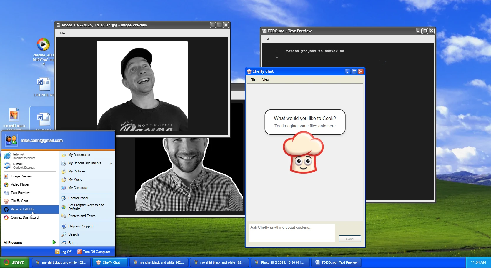

# Convex OS

This is a demo project that attempts to recreate parts of Windows XP using React and [Convex](https://convex.dev).

## Development

`bun install`
`bun run dev`

Tests run with `bun run test` (vitest + convex-test, no network, scheduled AI
jobs never fire).

## Cheffy cost limits

Anyone can sign up, and Cheffy calls OpenAI (`gpt-5` for replies, `gpt-5-mini`
for thread titles), so every message is budgeted before anything paid gets
scheduled. `my/cheffy:sendMessage` is the only public path to a paid call, and
it reserves one unit from two daily counters in the same transaction that
saves the message:

| Env var on the Convex deployment | Default | Meaning                               |
| -------------------------------- | ------- | ------------------------------------- |
| `CHEFFY_DAILY_USER_LIMIT`        | `20`    | Messages per user per UTC day         |
| `CHEFFY_DAILY_GLOBAL_LIMIT`      | `100`   | Messages across all users per UTC day |

Set either to `0` to switch Cheffy off. Missing or invalid values fall back to
the defaults. Counters live in the `cheffyUsage` table (one row per scope and
day), so a burst of fresh accounts still runs into the global cap.

Each message is also bounded (see `convex/cheffy/limits.ts`): 4,000 characters
of text, up to 3 attachments of 2MB each (checked against the stored file
size), the last 20 messages as context, 6,000 output tokens per reply
(gpt-5 counts its hidden reasoning against that, so replies run with low
reasoning effort to leave room for the answer), at most one provider retry,
and a short, minimal-reasoning title prompt. The caps count messages and
tokens rather than dollars; check current OpenAI pricing for what they cost.

Only the owner of a Cheffy window and thread can send to it, read it, or
point a window at a thread. The agent playground API (`convex/playground.ts`)
skips these budgets but needs an API key you issue yourself with
`npx convex run --component agent apiKeys:issue`.

`my/cheffy:listThreadMessages` only forwards stream delta cursors for streams
that the agent component lists under the caller's own thread (the newest 100,
which covers everything the client actually streams). A deleted thread lists
as empty and forwards no cursors.

## File uploads

`my/files:startUpload` returns a link to our own HTTP action
(`/files/upload` in `convex/http.ts`) with a single-use token that only
the file's owner sees, valid for an hour. The action stores the bytes and
links the new blob itself, so a client never supplies a storage ID and
knowing someone's blob ID doesn't let you adopt or delete it. The updated
frontend just checks for a 2xx response. Uploads
are capped at 20MB, the HTTP action body limit, and the stored size replaces
the client-declared one.

Frontends cached from before this change still call `startUpload` (so they
get the new link), read `storageId` from the upload response and then call
`my/files:completeUpload`. The response still includes `storageId` for them,
and `completeUpload` keeps its name and arguments but never writes anything.
It only succeeds for the file's owner when the upload action has already
linked that exact blob to that file. A file that's still uploading, belongs
to someone else or holds a different blob is refused and left unchanged.
A raw storage upload URL issued before the deploy can't be supported safely,
so finishing one gets an error asking the user to refresh and upload again.

Schema changes are additive: optional `uploadToken` and `startedAt` on the
`uploading` state, and a `by_storage` index on `files`. Existing files and
blobs are untouched. Uploads that were half-finished under the old flow
can't be completed (no token) and need re-uploading. Because the old flow let
anyone link a known storage ID, a blob might already be shared with someone
else's file; `deleteAll` only deletes a blob when no other file references
it. There's no backfill that could tell which link was the original, so any
such legacy link still has read access to that blob until it's deleted.
Deploy the backend and frontend together.

# Credits

I borrowed some icons from https://github.com/ShizukuIchi/winXP
CSS thanks to xp.css: https://botoxparty.github.io/XP.css/

### Vercel previews

Production builds deploy Convex and build the frontend as before. Preview builds only build the frontend, with no Convex deploy key in the child process. They use `VITE_CONVEX_URL` when supplied, otherwise the existing development deployment `moonlit-ladybug-819`. This prevents a production key configured in Vercel from deploying PR code to production.
